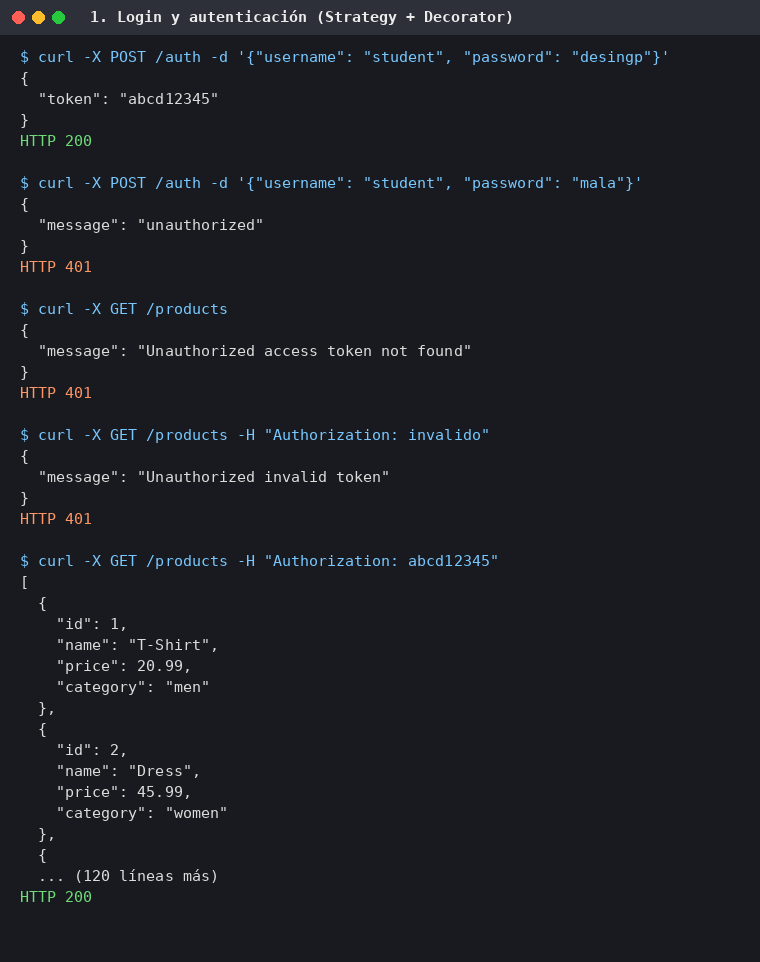
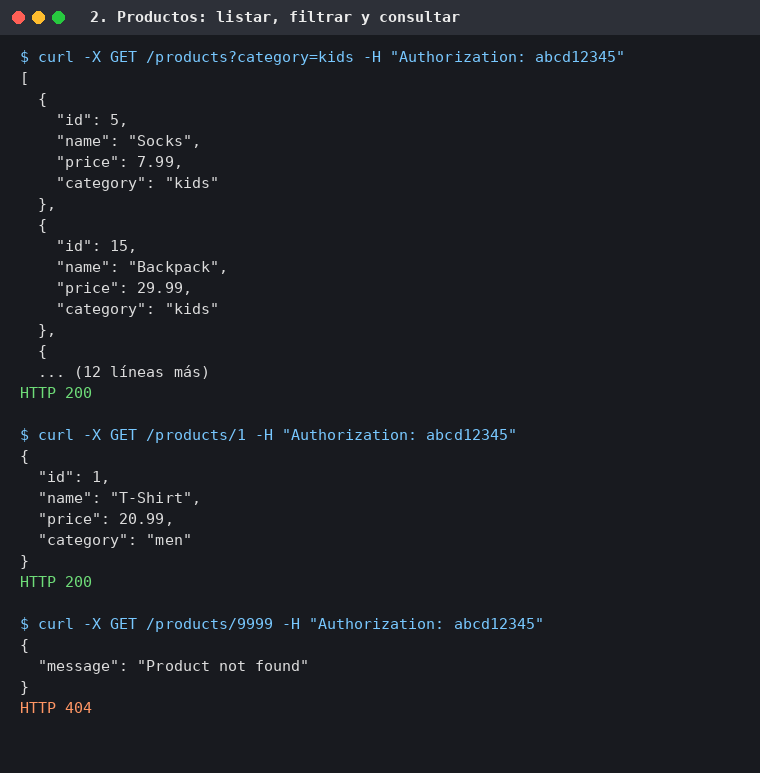
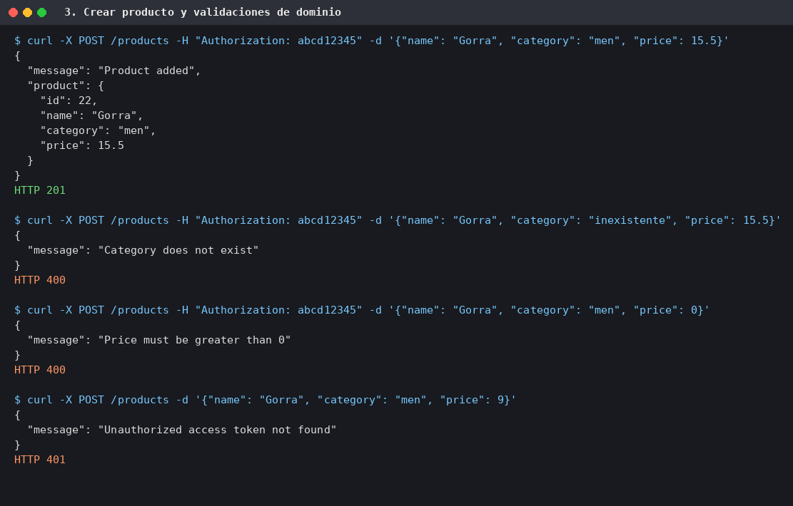
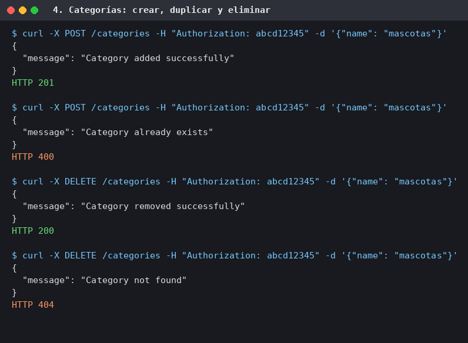
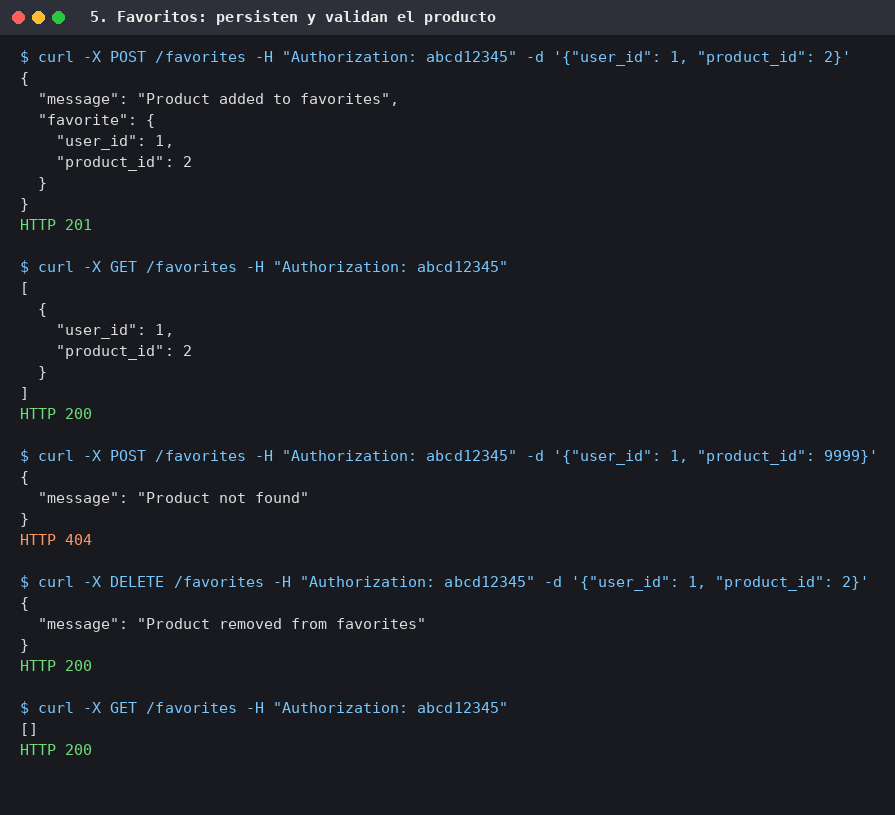
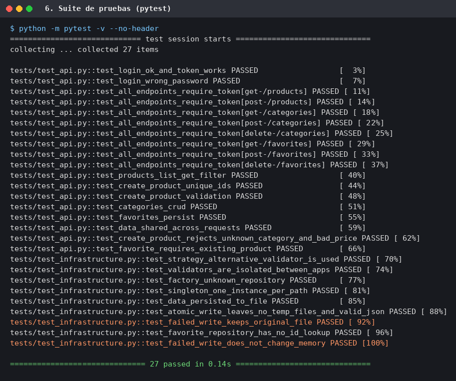
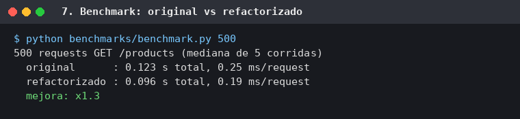
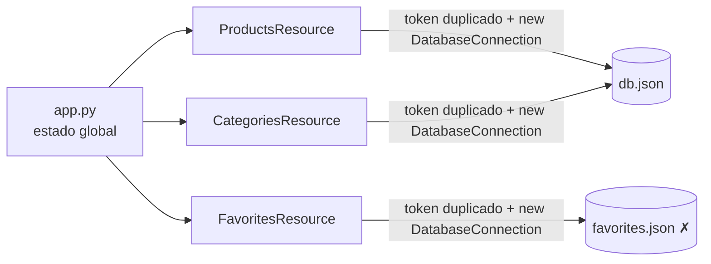
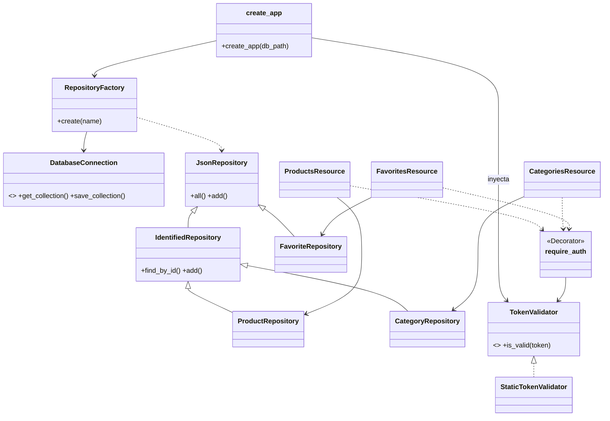

# REFLECTION.md — Análisis y refactorización de la API REST

## 1. Resumen
El proyecto original es una API REST (Flask + Flask-RESTful) para autenticación, productos, categorías y favoritos, con persistencia en `db.json`. Funcionaba parcialmente y tenía varios *code smells* y bugs reales. Se refactorizó en 5 commits aplicando 5 patrones de diseño y se añadió una suite de 27 pruebas (`python -m pytest`) y un benchmark (`benchmarks/benchmark.py`).

## 2. Problemas identificados (code smells)

| # | Problema | Dónde | Principio / smell |
|---|----------|-------|-------------------|
| 1 | `is_valid_token` copiado en 3 archivos y el bloque de validación de token repetido ~10 veces | `products`, `categories`, `favorites` | Código duplicado (DRY), *shotgun surgery* |
| 2 | **Bug**: `/auth` devuelve `abcd12345` pero la validación espera `abcd1234`; el token del login nunca funcionaba | `auth.py` vs resto | Números mágicos, inconsistencia |
| 3 | Credenciales y token fijos dentro del código | `auth.py` | Hard-coding, sin configuración central |
| 4 | `POST /products` no valida token aunque el README dice "required" | `products.py` | Seguridad inconsistente |
| 5 | Cada request crea un `DatabaseConnection` nuevo que relee el JSON; cada recurso guarda su propia copia de los datos | todos los `__init__` | Alto acoplamiento, estado duplicado, rendimiento |
| 6 | `DatabaseConnection` repite el patrón leer-modificar-escribir en 3 entidades y mezcla acceso a datos de todo el dominio (*God class*) | `database_connection.py` | Baja cohesión, violación de SRP/OCP |
| 7 | Endpoints mezclan HTTP, autenticación, validación y lógica de datos | `endpoints/*` | Violación de SRP; dependencia directa de la clase concreta (DIP) |
| 8 | `favorites.json` no existe: favoritos nunca se guardaban (devolvía 201 pero perdía el dato) | `favorites.py` | Bug silencioso, manejo de errores con `print` |
| 9 | Ids con `len(items)+1` → duplicados (el `db.json` tenía ids 21 y 23 repetidos) | products/categories | Bug de diseño |
| 10 | Comprobación de categoría duplicada compara un `str` con una lista de `dict` (siempre falsa) | `categories.post` | Bug lógico |
| 11 | `DELETE /categories` compara `cat["name"] != category_to_remove` (un dict) y llama `parse_args()` antes de declarar el argumento | `categories.delete` | Bug lógico, código muerto |
| 12 | Código muerto/ruido: `products` cargado en `app.py` sin usarse, imports sin usar (`Blueprint`, `Api`, `json`), `print("*****")`, parser creado y no usado | varios | Dead code |
| 13 | Respuesta con clave `mensaje` en vez de `message` | `products.post` | Inconsistencia de API |
| 14 | `app` global con estado y rutas en el módulo → no se puede probar con otra base de datos | `app.py` | Baja testabilidad |
| 15 | `__pycache__` versionado | repo | Higiene del repositorio |

| 16 | Autorización débil: el token es el mismo para todos y `user_id` viene en el body de `/favorites`, así que cualquier usuario autenticado puede leer o borrar favoritos ajenos | `favorites.py` | Control de acceso insuficiente |
| 17 | Escritura del JSON no atómica: si el proceso cae a mitad de `json.dump`, `db.json` queda corrupto | `database_connection.py` | Falta de robustez |
| 18 | Sin validación de dominio: se podía crear un producto con categoría inexistente o precio ≤ 0, y marcar como favorito un producto que no existe | `products.py`, `favorites.py` | Integridad de datos |

*Estado de los nuevos hallazgos:* 17 y 18 **se corrigieron** (sección 3.6); el 16 queda como **problema pendiente** (ver Anexo), porque resolverlo requiere un modelo de usuarios/JWT que excede el alcance de esta actividad.

*Verificado ejecutando el original:* login → 401 al usar su propio token; `POST /favorites` → 201 con favoritos vacíos después; categoría duplicada → 201.

## 3. Patrones aplicados

### 3.1 Strategy — validación de tokens (`auth/token_validator.py`)
**Problema:** la regla de validación estaba pegada a cada endpoint (smells 1–3).
**Solución:** interfaz `TokenValidator` con `StaticTokenValidator`. El validador se **inyecta** en `create_app(token_validator=...)` y se guarda en `app.extensions`, sin variables globales mutables; dos apps pueden tener validadores distintos (probado en `tests/test_infrastructure.py`). Cambiar a JWT solo requiere otra implementación, sin tocar endpoints (OCP).

### 3.2 Decorator — `@require_auth` (`auth/decorators.py`)
**Problema:** ~10 bloques idénticos de 4 líneas por método.
**Solución:** un decorador que envuelve el método y responde 401 si falta o es inválido el token. Cada método quedó con solo su lógica; además `POST /products` quedó protegido (smell 4).

### 3.3 Singleton — `DatabaseConnection` (`utils/database_connection.py`)
**Problema:** múltiples conexiones y copias de datos por request (smell 5).
**Solución:** una única instancia por archivo, con `RLock` para escrituras concurrentes del servidor de desarrollo. Todos los repositorios comparten la misma fuente de verdad. Incluye `reset()` para pruebas.
La escritura es **atómica** (archivo temporal + `os.replace`) y la memoria solo se actualiza si el disco se escribió bien. Limitación conocida: el lock protege dentro de un proceso, no entre varios workers.
*Decisión:* Singleton "por ruta" (no global absoluto) para poder usar un JSON temporal en tests.

### 3.4 Repository — `repositories/*` 
**Problema:** una clase con la lógica de persistencia de todo el dominio (smells 6, 7).
**Solución:** `JsonRepository` (`all`, `add`) e `IdentifiedRepository` (añade `find_by_id` e id = max+1) y repositorios específicos. `FavoriteRepository` hereda solo de `JsonRepository`, porque los favoritos no tienen `id` (así se respeta Liskov): `ProductRepository.find_by_category`, `CategoryRepository.find_by_name/remove_by_name`, `FavoriteRepository.add/remove`. Los endpoints dependen de una abstracción de acceso a datos y no del formato de almacenamiento (DIP): migrar a SQLite solo implica nuevos repositorios.

### 3.5 Factory — `RepositoryFactory` y `create_app()` (`repositories/factory.py`, `app.py`)
**Problema:** construcción de objetos dispersa y estado global (smell 14).
**Solución:** `RepositoryFactory.create("products")` centraliza la construcción; `create_app(db_path)` (Factory Method) ensambla Flask, rutas y repositorios inyectados con `resource_class_kwargs`. Permite probar con una base temporal.

### 3.6 Validaciones de dominio y mejoras de robustez
- `POST /products` rechaza (400) categorías inexistentes y precios ≤ 0; `POST /favorites` devuelve 404 si el producto no existe. Los repositorios exponen `exists(...)` para esto.
- Pruebas añadidas para estas reglas, la escritura atómica (incluido fallo de disco), el Singleton, el Factory y un validador alternativo.

### 3.7 Medición de rendimiento
`python benchmarks/benchmark.py 500` extrae el primer commit (original) y compara 500 `GET /products`, mediana de 5 corridas, con el `db.json` de ~24 productos:

| Versión | Total | Por request |
|---|---|---|
| Original (relee JSON y crea objetos por request) | 0.110 s | 0.22 ms |
| Refactorizada (Singleton, datos en memoria) | 0.075 s | 0.15 ms |

Mejora ≈ ×1.3–1.5 según la corrida (la medición varía unas décimas entre ejecuciones). Es una cifra modesta porque el archivo es pequeño; el beneficio crece con el tamaño de los datos. La principal ganancia del refactor es de mantenibilidad, no de velocidad.

### 3.8 Evidencias de funcionamiento tras la refactorización
Capturas de peticiones reales (`curl`) contra la API refactorizada, con una copia temporal de la base de datos (carpeta `docs/capturas/`):

**Login y autenticación** — token válido, credenciales malas y token ausente/inválido (401):


**Productos** — listar, filtrar por categoría, consultar por id y 404:


**Crear producto y validaciones** — 201 con datos válidos; 400 con categoría inexistente o precio 0; 401 sin token:


**Categorías** — crear, duplicado (400), eliminar y 404:


**Favoritos** — persisten, validan el producto (404) y se eliminan:


**Pruebas automáticas** — 27 pruebas pasan:


**Benchmark** — original vs refactorizado:


> Nota: son capturas de terminal generadas a partir de la salida real de las peticiones. Si el docente exige una herramienta concreta, se pueden sustituir por capturas de Insomnia o Postman con las mismas peticiones.

## 4. Diagramas

### Antes


### Después


## 5. Supuestos y decisiones de diseño
- **Token:** se tomó `abcd12345` (el que emite `/auth`) como válido; es la lectura más razonable de la intención del autor.
- **Favoritos** ahora se guardan en la clave `favorites` de `db.json` (ya existía, vacía), en lugar de un `favorites.json` inexistente.
- **Orden de prioridad en `GET /products`:** se conserva el original (filtro `category` antes que `product_id`).
- **`db.json` no se modificó** en la refactorización (tenía ids repetidos 21 y 23 por pruebas manuales del original; `db_bck.json` es la copia limpia y las pruebas usan una copia temporal).
- **Cambios intencionales de comportamiento** (todos corrigen bugs o añaden integridad): producto con categoría inexistente o precio ≤ 0 → 400; favorito de producto inexistente → 404; categoría duplicada → 400; `POST /products` exige token; clave `message`; favoritos persisten; `DELETE /categories` funciona correctamente.
- No se añadió Flask-JWT, SQLAlchemy ni blueprints: se evitó sobre-ingeniería para un API de 4 recursos.

## 6. Historial de commits
```
15cbdeb docs: REFLECTION.md y requirements.txt
f9057c9 test: suite de pruebas de la API (16 casos)
5675d46 refactor(data): Singleton + Repository + Factory; endpoints delgados; app factory
56e5947 refactor(auth): Strategy + Decorator para autenticación, config central
4532f1e chore: .gitignore y dejar de versionar __pycache__
5df6bc4 chore: proyecto original sin refactorizar (línea base)
```
Cómo verificar: `pip install -r requirements.txt && python -m pytest` → 16 passed.

## 7. Revisión con un par
*Autorrevisión previa (no sustituye la retroalimentación del compañero; completar con ella cuando se reciba).*

**Fortalezas identificadas**
- Cada patrón responde a un problema concreto y documentado (duplicación del token, copias de datos, construcción dispersa), sin sobre-ingeniería.
- Los endpoints pasaron de mezclar HTTP, autenticación y persistencia a ser delgados y legibles; la autenticación está en un solo lugar.
- Se corrigieron bugs reales del original (token inconsistente, favoritos que no persistían, categorías duplicadas, ids repetidos).
- Hay 27 pruebas automáticas, benchmark reproducible y un historial de commits descriptivo.

**Oportunidades de mejora detectadas y aplicadas**
- El validador de tokens era una variable global; ahora se inyecta en `create_app()`.
- `FavoriteRepository` heredaba `find_by_id` sin tener `id`; se separó la jerarquía (`JsonRepository` / `IdentifiedRepository`).
- La escritura del JSON no era atómica; ahora usa archivo temporal + `os.replace`.
- Se añadieron validaciones de dominio (categoría y producto existentes, precio > 0) y pruebas del Factory, del Strategy y de la escritura atómica.

**Pendiente (fuera del alcance de la actividad):** autorización por usuario y concurrencia entre procesos (ver Anexo).

## 8. Reflexión personal

**Lo más fácil.** Detectar los problemas evidentes: el `is_valid_token` copiado en tres archivos y el mismo bloque de validación repetido en casi todos los métodos. Una vez identificada la duplicación, el patrón Decorator la resolvió con muy poco código y el resultado se notó de inmediato en la lectura de los endpoints.

**Lo más desafiante.** Separar lo que era un bug de lo que era comportamiento intencional. Al ejecutar el original descubrí que el token del login no funcionaba, que los favoritos se "guardaban" sin persistir y que la categoría duplicada se aceptaba. Tuve que decidir cuánto cambiar sin romper el contrato de la API descrito en el README. Escribir las pruebas me ayudó a fijar esas decisiones y a comprobar que cada refactorización no rompía nada. También fue difícil resistir la tentación de sobre-ingeniar (JWT, SQLAlchemy, blueprints) cuando el proyecto solo tiene cuatro recursos.

**Patrones más útiles.**
- *Decorator*: fue el de mayor impacto inmediato, porque eliminó la mayor parte del código repetido.
- *Repository*: separó la lógica de negocio del formato de almacenamiento; cambiar de JSON a una base de datos ahora solo implicaría nuevos repositorios.
- *Singleton*: resolvió las copias inconsistentes de los datos, aunque exige cuidado con la concurrencia y con las pruebas (por eso incluí `reset()` y un lock).
- *Strategy* y *Factory*: aportan flexibilidad (cambiar la validación del token, inyectar otra base de datos en las pruebas), aunque su beneficio es menor en un proyecto tan pequeño.

**Aprendizaje principal.** Los patrones no se aplican por sí mismos: cada uno debe responder a un *code smell* concreto. Aquí cada patrón nació de un problema identificado y medible (duplicación, acoplamiento, baja cohesión), y por eso el código quedó más corto, más legible y más fácil de probar. Si lo repitiera, escribiría las pruebas de caracterización antes de tocar el código, para tener desde el inicio una red de seguridad.

**Qué mejoraría a futuro.** Reemplazar el token fijo por JWT con usuarios reales (aprovechando el Strategy ya existente), migrar la persistencia a una base de datos relacional, validar que el producto pertenezca a una categoría existente y agregar documentación OpenAPI.

## Anexo. Limitaciones y trabajo pendiente
- Autorización por usuario (`user_id` en el body de `/favorites`): requiere JWT con identidad; el Strategy ya permite incorporarlo.
- El lock del Singleton no cubre varios procesos; para producción haría falta una base de datos real.
- `reqparse` está obsoleto en Flask-RESTful; migrar a Marshmallow/Pydantic.
- Faltan `PUT`/`DELETE` de productos y `DELETE /categories/<id>`.
