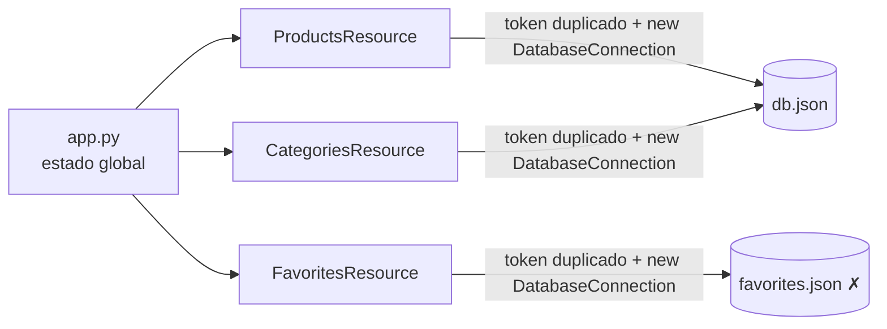
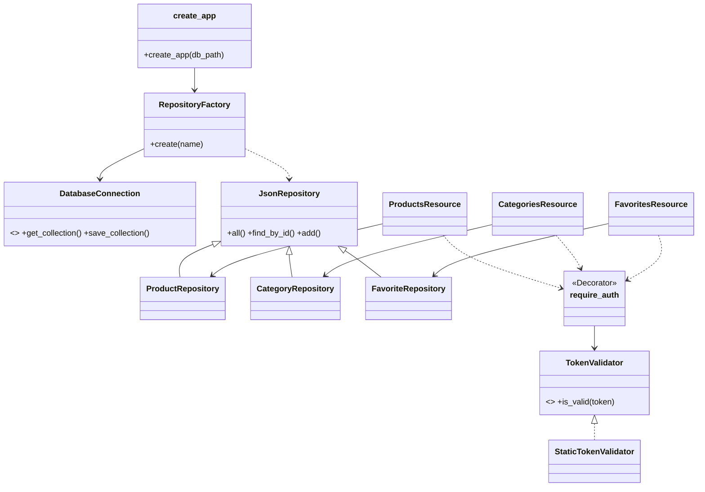

# REFLECTION.md — Análisis y refactorización de la API REST

## 1. Resumen
El proyecto original es una API REST (Flask + Flask-RESTful) para autenticación, productos, categorías y favoritos, con persistencia en `db.json`. Funcionaba parcialmente y tenía varios *code smells* y bugs reales. Se refactorizó en 5 commits aplicando 5 patrones de diseño y se añadió una suite de 16 pruebas (`python -m pytest`).

## 2. Problemas identificados (code smells)

| # | Problema | Dónde | Principio / smell |
|---|----------|-------|-------------------|
| 1 | `is_valid_token` copiado en 3 archivos y el bloque de validación de token repetido ~10 veces | `products`, `categories`, `favorites` | Código duplicado (DRY), *shotgun surgery* |
| 2 | **Bug**: `/auth` devuelve `abcd12345` pero la validación espera `abcd1234`; el token del login nunca funcionaba | `auth.py` vs resto | Números mágicos, inconsistencia |
| 3 | Credenciales y token fijos dentro del código | `auth.py` | Hard-coding, sin configuración central |
| 4 | `POST /products` no valida token aunque el README dice "required" | `products.py` | Seguridad inconsistente |
| 5 | Cada request crea un `DatabaseConnection` nuevo que relee el JSON; cada recurso guarda su propia copia de los datos | todos los `__init__` | Alto acoplamiento, estado duplicado, rendimiento |
| 6 | `DatabaseConnection` repite el patrón leer-modificar-escribir en 3 entidades y mezcla acceso a datos de todo el dominio (*God class*) | `database_connection.py` | Baja cohesión, violación de SRP/OCP |
| 7 | Endpoints mezclan HTTP, autenticación, validación y lógica de datos | `endpoints/*` | Violación de SRP; dependencia directa de la clase concreta (DIP) |
| 8 | `favorites.json` no existe: favoritos nunca se guardaban (devolvía 201 pero perdía el dato) | `favorites.py` | Bug silencioso, manejo de errores con `print` |
| 9 | Ids con `len(items)+1` → duplicados (el `db.json` tenía ids 21 y 23 repetidos) | products/categories | Bug de diseño |
| 10 | Comprobación de categoría duplicada compara un `str` con una lista de `dict` (siempre falsa) | `categories.post` | Bug lógico |
| 11 | `DELETE /categories` compara `cat["name"] != category_to_remove` (un dict) y llama `parse_args()` antes de declarar el argumento | `categories.delete` | Bug lógico, código muerto |
| 12 | Código muerto/ruido: `products` cargado en `app.py` sin usarse, imports sin usar (`Blueprint`, `Api`, `json`), `print("*****")`, parser creado y no usado | varios | Dead code |
| 13 | Respuesta con clave `mensaje` en vez de `message` | `products.post` | Inconsistencia de API |
| 14 | `app` global con estado y rutas en el módulo → no se puede probar con otra base de datos | `app.py` | Baja testabilidad |
| 15 | `__pycache__` versionado | repo | Higiene del repositorio |

*Verificado ejecutando el original:* login → 401 al usar su propio token; `POST /favorites` → 201 con favoritos vacíos después; categoría duplicada → 201.

## 3. Patrones aplicados

### 3.1 Strategy — validación de tokens (`auth/token_validator.py`)
**Problema:** la regla de validación estaba pegada a cada endpoint (smells 1–3).
**Solución:** interfaz `TokenValidator` con `StaticTokenValidator`. Cambiar a JWT o a una tabla de usuarios solo requiere otra implementación y `set_validator(...)`, sin tocar endpoints (OCP).

### 3.2 Decorator — `@require_auth` (`auth/decorators.py`)
**Problema:** ~10 bloques idénticos de 4 líneas por método.
**Solución:** un decorador que envuelve el método y responde 401 si falta o es inválido el token. Cada método quedó con solo su lógica; además `POST /products` quedó protegido (smell 4).

### 3.3 Singleton — `DatabaseConnection` (`utils/database_connection.py`)
**Problema:** múltiples conexiones y copias de datos por request (smell 5).
**Solución:** una única instancia por archivo, con `RLock` para escrituras concurrentes del servidor de desarrollo. Todos los repositorios comparten la misma fuente de verdad. Incluye `reset()` para pruebas.
*Decisión:* Singleton "por ruta" (no global absoluto) para poder usar un JSON temporal en tests.

### 3.4 Repository — `repositories/*` 
**Problema:** una clase con la lógica de persistencia de todo el dominio (smells 6, 7).
**Solución:** `JsonRepository` (CRUD genérico: `all`, `find_by_id`, `add`, id = max+1) y repositorios específicos: `ProductRepository.find_by_category`, `CategoryRepository.find_by_name/remove_by_name`, `FavoriteRepository.add/remove`. Los endpoints dependen de una abstracción de acceso a datos y no del formato de almacenamiento (DIP): migrar a SQLite solo implica nuevos repositorios.

### 3.5 Factory — `RepositoryFactory` y `create_app()` (`repositories/factory.py`, `app.py`)
**Problema:** construcción de objetos dispersa y estado global (smell 14).
**Solución:** `RepositoryFactory.create("products")` centraliza la construcción; `create_app(db_path)` (Factory Method) ensambla Flask, rutas y repositorios inyectados con `resource_class_kwargs`. Permite probar con una base temporal.

## 4. Diagramas

### Antes


### Después


## 5. Supuestos y decisiones de diseño
- **Token:** se tomó `abcd12345` (el que emite `/auth`) como válido; es la lectura más razonable de la intención del autor.
- **Favoritos** ahora se guardan en la clave `favorites` de `db.json` (ya existía, vacía), en lugar de un `favorites.json` inexistente.
- **Orden de prioridad en `GET /products`:** se conserva el original (filtro `category` antes que `product_id`).
- **`db.json` no se modificó** en la refactorización (tenía ids repetidos 21 y 23 por pruebas manuales del original; `db_bck.json` es la copia limpia y las pruebas usan una copia temporal).
- **Cambios intencionales de comportamiento** (todos corrigen bugs): categoría duplicada → 400; `POST /products` exige token; clave `message`; favoritos persisten; `DELETE /categories` funciona correctamente.
- No se añadió Flask-JWT, SQLAlchemy ni blueprints: se evitó sobre-ingeniería para un API de 4 recursos.

## 6. Historial de commits
```
f9057c9 test: suite de pruebas de la API (16 casos)
5675d46 refactor(data): Singleton + Repository + Factory; endpoints delgados; app factory
56e5947 refactor(auth): Strategy + Decorator para autenticación, config central
4532f1e chore: .gitignore y dejar de versionar __pycache__
5df6bc4 chore: proyecto original sin refactorizar (línea base)
```
Cómo verificar: `pip install -r requirements.txt && python -m pytest` → 16 passed.

## 7. Revisión con un par
*(Completar tras la revisión: observaciones recibidas, cambios aplicados y valoración del trabajo del compañero según la rúbrica.)*

## 8. Reflexión personal
*(Borrador para que lo adaptes con tu experiencia — es la parte que debe ser tuya.)*
- **Lo más fácil:** detectar la duplicación del token y de la lectura/escritura del JSON; Decorator y Strategy resolvieron el problema con muy poco código.
- **Lo más desafiante:** distinguir qué comportamientos eran bugs y cuáles intencionales, y decidir cuánto cambiar sin romper el contrato de la API. Escribir las pruebas ayudó a fijar esas decisiones.
- **Patrones más útiles:** Decorator (mayor reducción de código) y Repository (separa el dominio del almacenamiento y facilita cambiar de JSON a una BD).
- **Aprendizaje:** aplicar patrones sin un problema concreto añade complejidad; aquí cada uno nació de un smell identificado.
